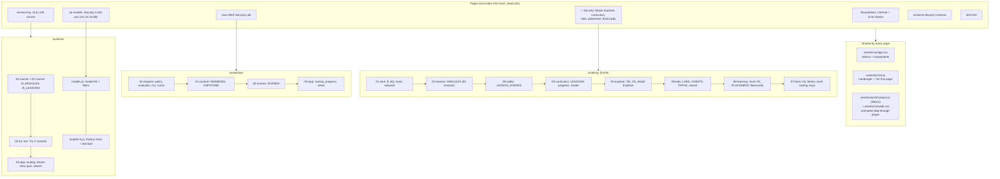
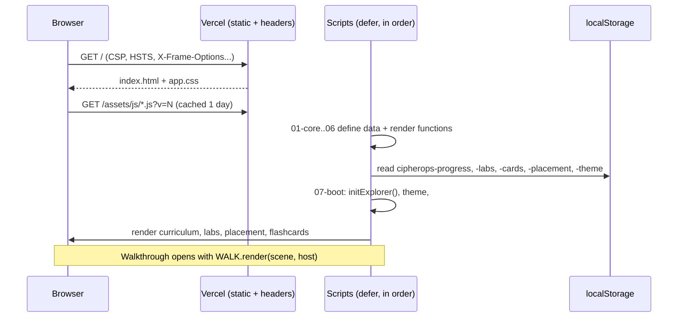
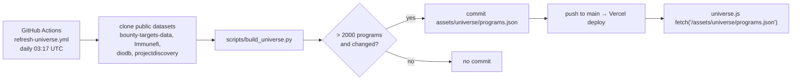

# cipherops_tech: architecture

A hands-on cybersecurity learning site: web, mobile, cloud, red team and LLM security, basic to advanced. It is a **static site with no framework, no backend and no build step for the pages**. Every page is plain HTML plus a few ordered `<script defer>` files. All labs and attacks are simulated in the browser, and progress lives in the visitor's `localStorage`.

This document describes how the site is put together today, the rules every change follows, and where it is going. The README covers what's on the site and how to deploy it.

## Contents

- [Stack](#stack)
- [Rules for every change](#rules-for-every-change)
- [Pages and layers](#pages-and-layers)
- [A page load, end to end](#a-page-load-end-to-end)
- [Content model](#content-model)
- [Shared engines](#shared-engines)
- [3D](#3d)
- [State](#state)
- [Security headers and the CSP](#security-headers-and-the-csp)
- [Data pipeline: Bounty Universe](#data-pipeline-bounty-universe)
- [Deploy](#deploy)
- [Checking a change](#checking-a-change)
- [Adding things](#adding-things)
- [Known gaps and where it is going](#known-gaps-and-where-it-is-going)

## Stack

| Concern | Choice | Why |
|---|---|---|
| Pages | Hand-written HTML, one `index.html` per section | No build step; anyone can open a file and edit it |
| Script | Vanilla ES2020 in ordered `defer` scripts | Works under a strict CSP with no bundler; files load in document order |
| Styles | `assets/css/app.css` (tokens + components), plus one stylesheet per section | One design system, scoped extras per page |
| Diagrams | Inline SVG drawn by script (Attack Explorer, walkthrough player) | Crisp at any size, themeable, no WebGL needed |
| 3D | three.js, self-hosted: r128 UMD (`assets/universe/three.min.js`), r187 bundled into `assets/ai/models-fx.js` | Script must come from our own origin (CSP) |
| Fonts | Barlow Semi Condensed, Barlow, JetBrains Mono from Google Fonts | Allowed by the CSP (`fonts.googleapis.com`, `fonts.gstatic.com`) |
| Hosting | Vercel, static, `cleanUrls` | Auto-deploy on push to `main`; headers in `vercel.json` |
| Analytics | Vercel Web Analytics (`/_vercel/insights/script.js`, same origin) | No third-party script host |
| Data jobs | GitHub Actions + Python (`scripts/build_universe.py`) | Daily refresh of public bug bounty data |

## Rules for every change

- **No inline scripts, no `eval`, no CDN JavaScript.** The CSP is `script-src 'self'`. Every script is a file in `assets/` served from our own domain. Third-party libraries are vendored (with their licence in `NOTICE.md`).
- **Inline styles are allowed** (`style-src 'unsafe-inline'`), but prefer classes and tokens from `app.css`.
- **Design tokens, not raw colours.** Use `--paper`, `--navy`, `--teal`, `--teal-2`, `--amber`, `--red`, `--r-lg`, `--r-md`, `--lift`, `--f-head`, `--f-body`, `--f-mono`. Reuse `.card`, `.btn(.primary/.ghost/.sm)`, `.tag(.basic/.intermediate/.advanced)`, `.chips`, `.eyebrow`, `.lede`, `.muted`, `.wrap`.
- **Light and dark themes.** The theme is `html[data-theme]`, stored as `cipherops-theme`. Every page applies it on load and redraws theme-aware graphics when it changes.
- **Respect reduced motion.** Check `prefers-reduced-motion` before any animation loop (`reduced` in `01-core.js`).
- **No sideways scroll at 390 px.** The top nav collapses to the ☰ menu below 1460 px (`app.css` and `nav.js`).
- **Everything is simulated.** Labs and attacks never touch a real target. Content stays concept-level and defensive, and real-system steps say "only with written permission".
- **Original writing.** Lessons are our own text. "Go deeper" links point to OWASP, PortSwigger, MITRE, HackTricks and so on, but we don't copy them. Content sourcing rules are in the project notes and `NOTICE.md`.
- **Bump the `?v=` query** on a script or stylesheet tag whenever that file changes (`/assets/...` is cached for a day with stale-while-revalidate).
- **Wrap every `localStorage` call in `try/catch`.** Storage can be missing or throw (private mode, sandboxed frames).

## Pages and layers

Script order matters: the home page loads `01-core → 02-lessons → aws/04-player → 08-walks → 03-curriculum → 04-explorer → 05-labs → 06-learning → 07-boot → nav`. Later files read the globals (`MODULES`, `LESSON_SCENES`, `XS`, `LABS`, `WALK`) that earlier files define. `07-boot.js` is always last and is the only file that starts things.

Page modules on `/aws` and `/ai-learning` wrap their app code in an IIFE and keep only their content arrays global (`AWSMODS`, `SCENES`, `AI_LESSONS`).

## A page load, end to end

Routing is hash-based on each page. Examples: `/#sqli` opens a lesson, `/#lab-sqli` opens a lab, and `/aws#...` and `/ai-learning#...` route inside their app.

## Content model

Content is **data in JS arrays**. Render code never hard-codes a lesson.

### Curriculum lesson (`MODULES` in `02-lessons.js`)

There are 6 modules (`basics`, `web`, `mobile`, `cloud`, `red`, `llm`) and 52 lessons. A lesson's fields:

| Field | Meaning |
|---|---|
| `id`, `title`, `level` (`basic`/`intermediate`/`advanced`), `min` | Identity and size |
| `body[]` | Paragraphs (may contain `<code>` and `<b>`) |
| `keys[]` | Key ideas |
| `check` | The quick-check question (also feeds the placement test and flashcards) |
| `links[]` | "Go deeper" pairs, built with helpers `HT`, `PS`, `CS`, `PA`, `AT`... |
| `example`, `callout`, `cheat` | Optional extras |
| `sim` | Ties the lesson to an Attack Explorer scenario (`payload`, `gate`, `patched`, `target`) |
| `lab` | Id of the CTF lab that practises it |

`03-curriculum.js` flattens these into `LESSONS` (adding `mod`, `mi`, `li`) and renders the sidebar, the module strip and the reader. If `LESSON_SCENES[id]` exists, the lesson opens with an animated walkthrough.

### Attack Explorer scenario (`XS` in `04-explorer.js`, more in `06-learning.js`)

There are 18 scenarios. Each has `{id, cat, title, sub, sev, lesson, lab, desc, props, steps, packets, def}`.

- `props`: the overview table (OWASP, CWE or ATT&CK, target, entry, impact, detect, fix).
- `packets`: rows built with `p(src, dst, proto, info, kind, stage, raw, fields)`. `kind` is `atk`, `alert`, `blk` and so on, `stage` indexes the kill chain, and `fields` drive the byte decoder.
- `def`: the defence replay `{ctrl, node, from, explain, packets}`. It swaps in safe packets from index `from`.
- Nodes come from `XN` (user, attacker, DNS, WAF, app, SIEM, S3, DB, LLM, IMDS, evil). A scenario can relabel nodes with `labels`.

### Walkthrough scene (`LESSON_SCENES`, `SCENES`, AI lesson `.scene`)

All three use one shape: `{title, legend, nodes[{id, kind, x, y, label, sub, glyph, c}], edges, metrics, learn[], steps[{short, tag, t, p[], ...}]}`. They are rendered by the shared `WALK` player.

### Lab (`LABS` in `05-labs.js`)

There are 12 labs: `{id, title, mod, level, points, learn, brief, hints[], flag, render}`. `flag` is base64-encoded so it isn't in plain view. `render` is the lab's own function (`labSQLi`, `labTerminal`, `labJWT`...), which builds a simulated target inside the lab view.

### AWS module (`AWSMODS` in `aws/01-content.js`)

There are 12 services plus a `CAPSTONE` incident. Each has `{id, svc, name, group, level, min, tag, ...}` with a walkthrough scene, a reference lesson, a browser lab (from `ENGINES`), a quiz, and a guided real-account lab with a CloudFormation template in `assets/aws/cfn/NN-*.yaml`.

### AI course (`AI_MODULES` and `AI_LESSONS` in `ai/01-course.js` and `02-course.js`)

There are 6 modules and 23 lessons, added with `addL()`. Each lesson has a `scene` for the player, code samples, and a quiz. `04-try.js` attaches live controls (`scene.try`) whose numbers are illustrative models.

### Foundations (`/foundations`, `assets/found/`)

The start-here section uses the new lesson layout: Goal → How it works → Explore (or The 10 commands) → Try it → Why it matters → Check → Next up, with a pinned section nav.

- `01-net.js`: `NET_LESSONS`, 8 internet lessons. Each has `{id, title, min, goal, learn[], intro[], scene, widget, missions[], why[], quiz[]}`. The `scene` uses the `WALK` player's format. Its text is written with `<code>`/`<b>` and converted to the player's backtick/`**` markdown at render time.
- `02-linux.js`: `FOUND_CMDS`, the 100 commands `{c, g, d, s, e[[cmd, meaning]], sec}`, which also feed `man` in the terminal, plus `LINUX_LESSONS` (10 lessons, 10 commands each, linked by `g`).
- `03-shell.js`: `SHELL.create(host, {onRun})`, a simulated Ubuntu terminal. It has a fake file system with owners and modes, users with `sudo`, processes and jobs, and canned DNS/HTTP/TLS answers. It supports pipes, `>`/`>>`/`2>`, `;`/`&&`/`||`, quotes, `$VAR`, `~`, globs, aliases, executable scripts, history and Tab completion. It covers all 100 commands plus a few extras.
- `04-app.js`: routing (`#lesson-id`, `#commands`), the sidebar, the widgets (`packets`, `ipcalc`, `ports`, `records`, `http`, `sniff`, `osi`, `url`) and progress.
- A mission is `{t, h, c(ev, T)}`. After every command the terminal calls `onRun(ev, T)` with `ev = {line, cmds, out, err, code}`, and each open mission's check runs against it. One terminal instance is shared across lessons, so files you make persist until you press Reset.

### Security LLMs (`M` in `ai/models.js`)

There are 17 entries with `{kind: sec/gen/tool, name, by, host, url, what, best, tasks[], size, file, hw, vram, licence, catchTxt, run}`, plus a `CHECKED` date. The filters are `KINDS`, `TASKS` and `HW` (`HW` is an ordered array).

## Shared engines

- **`WALK` player** (`assets/aws/04-player.js`): `WALK.render(mod, scene, host, opts)` draws an isometric SVG stage and animates flows step by step. It has keyboard keys (← →, 1–9, R, Space, F), speed, replay, full screen, and remembers the furthest step (`cipherops-walk-<id>`). It is self-contained (it has its own DOM helpers), so any page can use it. It's used by the home curriculum, `/aws` and `/ai-learning`.
- **Attack Explorer** (`04-explorer.js`): Network and Sequence views, the kill-chain bar, the packet table with Play/Step/Reset and speed, the byte decoder, and the Defence toggle. Drawn with SVG (no WebGL).
- **Lab renderers** (`05-labs.js`): a simulated terminal (`term`), DevTools network panel, APK viewer, bucket listing, JWT editor, prompt-injection chatbot, SSTI with a safe maths parser (no `Function()`), beacon hunting and an IAM policy check.
- **AWS engines** (`aws/02-engines.js`): an IAM policy evaluator (`IAMSIM`), a simulated AWS CLI (`parseCli`), a CloudTrail hunt, findings triage and a console builder (`labPolicy`, `labCli`, `labHunt`, `labTriage`, `labConsole`, `labShell`).
- **Search** (`05-labs.js`): an index over lessons, labs and cheat sheets. Open it with `/` or Ctrl+K.
- **Placement and flashcards** (`06-learning.js`): 12 placement questions taken from lesson checks, and Leitner spaced repetition (`INTERVALS` 0/1/3/7/16/35 days).

## 3D

- **Bounty Universe** (`/universe`) uses vendored three.js **r128** UMD (`assets/universe/three.min.js`). It draws 2,800+ programs as a 3D universe, with Bubble and List fallbacks.
- **Security LLMs hero** (`/ai-models`): `assets/ai/models-fx.js` is an esbuild IIFE bundle of three.js **r187** (tree-shaken) plus the scene and terminal demo. It's a node lattice, theme-aware via a `MutationObserver` on `data-theme`. It pauses off screen and when the tab is hidden, honours reduced motion, and adds `no-webgl` to its host on failure.
- **Rule:** 3D is for structure and space (networks, accounts, the course map). Text-level ideas, such as how a query is built, stay in readable 2D. Every 3D view has a non-WebGL fallback that tells the same story.

## State

| State | Key | Shape | Written by |
|---|---|---|---|
| Lessons done | `cipherops-progress` | `[lessonId]` | 03-curriculum |
| Labs solved, hints used (site-wide points and rank) | `cipherops-labs` | `{solved:{id:pts}, hints:{}}` | 05-labs, aws/03-app |
| AWS quizzes and seen pages | `cipherops-aws` | `{quiz:{}, seen:{}}` | aws/03-app |
| AWS lab sandboxes | `cipherops-<service>` (iam, scp, kms, ...) | per engine | aws/02-engines |
| Walkthrough furthest step | `cipherops-walk-<id>` | `{max}` | 04-player |
| Flashcards | `cipherops-cards` | Leitner boxes | 06-learning |
| Placement result | `cipherops-placement` | answers and level | 06-learning |
| Explorer scenarios seen | `cipherops-xseen` | ids | 04-explorer |
| AI course | `cipherops:ai:progress`, `:last`, `:prefs`, `:recent` | `{id:{max, done, quiz}}` | ai/03-app |
| Foundations | `cipherops-foundations` | `{done:{id}, m:{id:[mission idx]}, quiz:{id:{q:a}}, last}` | found/04-app |
| Theme | `cipherops-theme` | `light` / `dark` | every page |
| Universe intro dismissed | `bu-intro` | `"1"` | universe.js |

Points and rank (`RANKS`, from Novice to cipherops Elite at 1500) are computed from `cipherops-labs`, so CTF and AWS labs count toward the same rank. Nothing leaves the browser.

## Security headers and the CSP

From `vercel.json`, for every path:

- **Content-Security-Policy:** `default-src 'self'; script-src 'self'; style-src 'self' 'unsafe-inline' https://fonts.googleapis.com; font-src 'self' https://fonts.gstatic.com; img-src 'self' data:; connect-src 'self'; object-src 'none'; base-uri 'self'; form-action 'self'; frame-ancestors 'none'; upgrade-insecure-requests`
- **Other headers:** HSTS (2 years, preload), `X-Content-Type-Options: nosniff`, `X-Frame-Options: DENY`, `Referrer-Policy: strict-origin-when-cross-origin`, a `Permissions-Policy` that denies camera, microphone, geolocation, payment and USB, and `Cross-Origin-Opener-Policy: same-origin`.
- **Cache:** `/assets/*` is cached `max-age=86400, stale-while-revalidate=604800`, which is why `?v=` must be bumped.

What follows from this: `fetch` only reaches our own origin (`connect-src 'self'`), so all data, such as `programs.json`, is shipped as static files. Images must be our own or `data:` URIs. Pages can't be framed.

## Data pipeline: Bounty Universe

## Deploy

- Push to `main` and Vercel builds nothing: it serves the repo as is, with `cleanUrls` (`/aws` → `aws/index.html`).
- Live at `https://cipherops-tech.vercel.app`. `sitemap.xml`, `robots.txt`, `site.webmanifest` and `og.png` sit at the root.
- Commits made by assistants end with the attribution lines the team uses.

## Checking a change

There's no test runner yet. Before calling a change done:

1. Serve the folder (`python3 -m http.server 8000`) and open each affected page at **desktop (1440 px), laptop (1280 px) and phone (390 px)**, in light and dark themes.
2. Check that the console has **no errors and no CSP violations**. The local server doesn't send the CSP, so check the live preview or production too.
3. Run the affected flows: lessons open, the walkthrough steps, the Explorer plays with and without the defence, labs accept their flag, and progress survives a reload.
4. For 3D, check a WebGL run (headless Chrome: `--use-angle=swiftshader --enable-unsafe-swiftshader`) and the no-WebGL fallback.
5. After the push, wait for the deploy and recheck the live URL.

## Adding things

- **A lesson:** add an object to the right module in `MODULES` (`02-lessons.js`). For an animated opener, add a scene under the same id in `LESSON_SCENES` (`08-walks.js`). Link it to a scenario (`sim`) and a lab (`lab`) if one exists. The search index, sidebar and counters pick it up.
- **An Attack Explorer scenario:** push to `XS` (`04-explorer.js`, or `06-learning.js` for the newer ones) using `p()` packets and a `def` replay. Set `lesson` and `lab` so it cross-links.
- **A lab:** add to `LABS` with a `render` function in `05-labs.js`. Base64 the flag and keep the target fully simulated.
- **An AWS module:** add to `AWSMODS` and a scene to `SCENES`, pick or write an engine in `02-engines.js`, and add a CloudFormation template `assets/aws/cfn/NN-name.yaml`.
- **An AI lesson:** `addL({...})` in `01-course.js` or `02-course.js`, with a `scene` and an optional `scene.try` in `04-try.js`.
- **A page:** a new `folder/index.html` that copies the shared head (fonts, `app.css`, theme bootstrap, insights) and the header and nav markup, then add the link to the main nav on every page, `sitemap.xml` and the README.
- **A library:** vendor it under `assets/`, record its licence in `NOTICE.md`, and never load it from a CDN.

## Known gaps and where it is going

These are honest debts, followed by the planned direction (see the project's *CipherOps learning experience plan*).

- **Duplicated helpers.** `el()`, `ael()` and `h()` are near copies on each page. Plan: one `assets/js/dom.js`.
- **The `models-fx.js` source and build script live outside the repo.** Plan: commit them under `tools/fx/` with the esbuild command.
- **No automated checks.** Plan: a small Node script, run in CI, that checks every lesson has `check`/`keys`, every `lesson`/`lab`/`sim` id resolves, every `?v=` tag exists, and that no inline `<script>` exists.
- **Lesson layout.** Next is the standard lesson sheet (Goal → Learn → How it works → Try it → Defend it → Check → Next up) with a pinned section nav, "commands, in order" tables for labs, a **Read the code** tab (vulnerable vs fixed, guess-first tour, phrasebook), and level settings (Beginner / Practitioner / Deep dive, Calm motion). A working SQL injection prototype exists. It moves into the site as new optional lesson fields (`commands`, `code`, `journey`) rendered by `03-curriculum.js`, and saves to the existing progress keys.
- **Reference atlas and coverage map** (OWASP Top 10, LLM Top 10, CWE Top 25, ATT&CK, AWS services) that lights up from completed labs.
- **"Meet the network" 3D course map**, offline (PWA), self-hosted fonts so the CSP can drop Google, and later translations.
